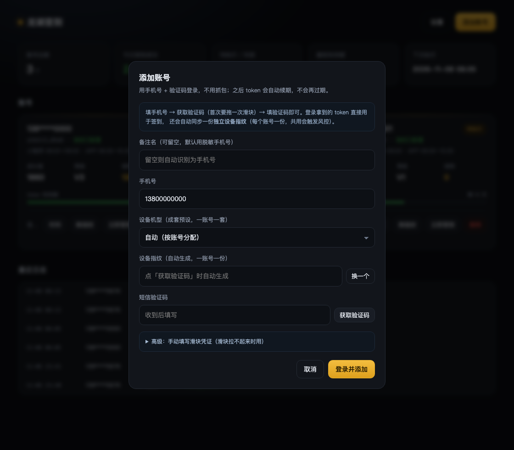

# 龙湖天街自动签到

一个自带 Web 看板的龙湖会员每日签到服务。**手机号 + 验证码添加账号，不用抓包；添加一次之后全自动**——token 会在每次执行时自动续期，也不依赖青龙面板。


[](https://linux.do)


> 截图为演示数据：账号名用脱敏手机号，token、成长值等均为示例值，不含任何真实账号信息。

## 目录

- [添加账号：手机号登录](#添加账号手机号登录)
- [功能特性](#功能特性)
- [快速开始](#快速开始)
- [使用说明](#使用说明)
- [配置项](#配置项)
- [HTTP API](#http-api)
- [工作原理](#工作原理)
- [成长值与会员等级](#成长值与会员等级)
- [目录结构](#目录结构)
- [数据与备份](#数据与备份)
- [常见问题](#常见问题)
- [安全提醒](#安全提醒)
- [社区](#社区)
- [免责声明](#免责声明)

## 添加账号：手机号登录

> 2026-11-07 更新：这一节原来的结论「做不成手机号 + 验证码登录」**已作废**。
> 当时只排查了小程序 / 微信 passport 链路，漏了 **App 端自己的短信登录接口**。

网页「添加账号」**只有手机号登录一种方式**，三步走，全程不用抓包：

1. 填手机号 → 点「获取验证码」。服务端按手机号签一份**独立设备指纹**
   （`app/dxrisk.py`，纯标准库；一账号一份，共用指纹会触发风控）。
2. 首次发送会返回 `909001 请操作图形验证`，看板自动拉起顶象滑块，**手动拖一次**；
   通过后把 `<滑块token>:<当次指纹c>` 作为 `riskToken` 重发，短信就到了。
   滑块跑在用户自己的浏览器里（`app/static/slider.js`），服务端不需要装浏览器。
   滑块实在拉不起来时，面板「高级」里可以手填凭证。
3. 填收到的验证码 → 「登录并添加」。服务端换到 token，校验资料后直接写库，
   并把这份指纹存进 `dx_token`，新账号立刻具备 APP 入口，不用再「补指纹」。



### 设备机型预设

添加账号面板有一个「设备机型」下拉，默认**自动（按账号分配）**，也可以手动指定。
服务端提供 5 套成套自洽的公开机型预设：Google Pixel 7、Xiaomi 14、OnePlus 12、
vivo X100、Samsung Galaxy S24，列表由 `GET /api/device/profiles` 返回。

之所以是「成套」而不是自由填字段：顶象 `/udid/m1` 会校验品牌、机型、代号、
build fingerprint、UA 之间的一致性，只改其中一项会直接返回 `-10005`。因此每套预设
一次性覆盖这组字段，其余硬件与结构性字段沿用脱敏模板，不引入任何真实设备痕迹；
面板只允许选预设，**不开放字段编辑**。

自动模式按「已有账号数 + 手机号哈希」轮转分配，尽量让多个账号分散到不同机型画像，
避免上游看到一批账号都来自同一套设备模板。选好机型后点「获取验证码」才会按该模板
签发指纹，中途改机型会清空已签指纹并要求重新生成；**已有账号的 `dx_token` 不受影响**。

登录拿到的 token 与现有签到链路完全通用（用 `probe_token` 在 `C20400/C2`
和 `L00602/L0` 两种网关都验证过）。导入之后 token 仍由服务自动滚动续期，
有效期 30 天且滑动过期，服务每天跑就永远不会失效；只有**连续停机超过 30 天**
才需要用手机号重新登录一次（日志里会出现 `token2key 未返回 key`）。

备注名留空时默认用**脱敏手机号**（如 `138****0000`）当显示名——龙湖昵称对所有账号
都是「珑珠用户」，只有手机号能把多个账号区分开。提交验证码后会先调用户信息接口
校验 token，通过才写库，不会产生无效账号。账号可随时删除，也可点「立即签到」
手动跑一轮（续期 + 两个入口 + 刷新资料）。

| 接口 | 作用 |
|---|---|
| `POST /supera/mine/v1_30_2/publicApi/login/sendSmsCodeSecret` | 发送验证码（首次需顶象滑块 `riskToken`） |
| `POST /supera/mine/v1_30_2/publicApi/login/smsCodeSecret` | 提交验证码，返回 `token` / `lmid` |

实现在 `app/login.py`。签名头 `X-LONGZHU-Sign` 的算法见「请求签名」一节，
**注意 App 端要用 `app` 那套密钥（`app/login.py` 的 `SIGN_SECRET_APP`），
不是小程序的 `microApp` 密钥**（`app/longhu.py` 的 `SIGN_SECRET_MICRO_APP`）。

<details>
<summary>早期微信 passport 链路的排查记录（已不需要，仅存档）</summary>

龙湖的账号体系里，手机号只是**绑定在微信身份上的附属信息**，不是独立登录凭证。这一点经过实测确认：

| 探测接口 | 结果 |
|---|---|
| `/api/passport/wxLogin/v1/sendSms`（不带 ticket） | `900700 绑定有效期已过，请返回后重新绑定` |
| `/api/passport/wxLogin/v1/check`（空参数） | `20001 三方类型不能为空；临时凭证不能为空；应用id不能为空` |
| 全站 `thirdType` 取值 | 只有一个：`wx-pub` |
| 密码登录接口 | 不存在（`setPassword` / `forgetPassword` 属于钱包支付密码） |

整个 passport 模块只有 4 个接口，`ticket` 必须由微信客户端生成的 `authCode` 换取，
脚本无法凭空构造 —— 但 App 端另有一套登录接口，不必走这里。

</details>

## 功能特性

- **多账号管理**：一个面板管多个龙湖账号，卡片式展示
- **一种添加方式**：手机号 + 验证码，不用抓包；提交时立即校验，不留脏数据
- **自动配指纹**：手机号登录时自动给新账号签一份独立顶象指纹，首次滑块在浏览器里手动拖一次即可
- **token 自动续期**：每次执行前滚动续期，有效期重置为 30 天 → 导入一次后不会再过期
- **随机签到窗口**：默认在 08:00–09:00 之间随机取一个时刻执行，每天不同，页面上改完立即生效，无需重启
- **双入口签到**：一次导入，小程序与 APP 两个签到活动各签一次，成长值叠加（APP 入口需配套 App 内设备指纹）
- **状态看板**：成长值、等级、珑珠余额、token 剩余天数、签到历史
- **严格三态判定**：区分「签到成功 / 今日已签 / 鉴权失败」，不会把失败当成功（这是很多同类脚本的隐患）
- **失败告警**：续期或签到失败时推送 **Bark / 企业微信 / 钉钉**，类型自动识别
- **零外部依赖**：SQLite 单文件存储，一个容器跑完，不需要数据库和青龙

## 快速开始

### Docker Compose（推荐）

```bash
git clone https://github.com/ken861222/longhu-checkin.git
cd longhu-checkin

docker compose up -d --build
```

打开 `http://你的IP:8088` 即可。数据落在 `./data/longhu.db`。

> `docker-compose.yml` 里默认用清华 pip 源加速构建。如果在海外服务器构建，把 `PIP_INDEX_URL` 那行删掉会更快。

### Docker CLI

```bash
docker build -t longhu-checkin .

docker run -d --name longhu-checkin \
  --restart unless-stopped \
  -p 8088:8000 \
  -v $(pwd)/data:/data \
  -e TZ=Asia/Shanghai \
  longhu-checkin
```

### 从源码运行

```bash
python3 -m venv .venv
source .venv/bin/activate        # Windows: .venv\Scripts\activate
pip install -r requirements.txt

DATA_DIR=./data uvicorn app.main:app --host 0.0.0.0 --port 8000
```

需要 Python 3.10+（用到了 `dict | None` 语法）。

## 使用说明

### 看板

顶部五个指标：账号总数、今日签到成功数、待执行/失败数、最短 token 剩余天数、下次执行时间。

账号卡片显示：账号名（默认脱敏手机号）、token 脱敏值、成长值、等级、珑珠余额、token 有效期进度条、最近一次签到结果。

### 设置

- **签到窗口**：起点默认 `08:00`，随机浮动默认 `60` 分钟，即每天在 **08:00–09:00 之间随机取一个时刻**执行，秒级随机，每天都不一样。浮动填 `0` 就退化成固定时刻。保存后立即重新排程，顶部「下次执行」会显示摇到的具体时间
- **告警推送地址**：Bark / 企业微信 / 钉钉三选一，**类型自动识别，不需要选**

### 告警推送

失败时推一条消息，避免「静默漏签」——这个项目的旧脚本就踩过坑：token 失效时把空响应当成「今日已签到」，日志显示成功但实际没签到。现在只要续期失败或签到失败，就会走告警。

**Bark（iOS，推荐个人用）**

填 Device Key 对应的地址即可，官方服务和自建服务都支持：

```
https://api.day.app/你的DeviceKey                    # 官方
https://bark.example.com/你的DeviceKey               # 自建
```

服务会 POST 到 `<你的域名>/push`，报文为：

```json
{
  "device_key": "你的DeviceKey",
  "title": "龙湖签到",
  "body": "【龙湖签到】1 个账号异常\n· 测试账号: token 已失效",
  "group": "龙湖签到"
}
```

推送会归到「龙湖签到」分组，历史消息好找。

**企业微信 / 钉钉群机器人**

填完整的 webhook 地址：

```
https://qyapi.weixin.qq.com/cgi-bin/webhook/send?key=xxxxxxxx
https://oapi.dingtalk.com/robot/send?access_token=xxxxxxxx
```

报文是标准的 `{"msgtype": "text", "text": {"content": "..."}}`。

三种类型的识别规则：域名是 `day.app` 或其子域 → Bark；域名是 `qyapi.weixin.qq.com` / `oapi.dingtalk.com` → 群机器人；其余情况若路径只有一段（形如 `/DeviceKey`）→ 视为自建 Bark。

> 推送会忽略系统代理（`trust_env = False`），不受本机代理设置影响。

### 日志

页面底部是全局日志，也可通过 `GET /api/accounts/{id}/logs` 看单个账号。每条记录带动作类型（绑定 / 续期 / 签到 / 查询）和状态（ok / already / fail）。

## 配置项

| 环境变量 | 默认值 | 说明 |
|---|---|---|
| `DATA_DIR` | `/data` | SQLite 数据库存放目录 |
| `TZ` | `Asia/Shanghai` | 时区，影响定时任务的触发时刻 |

页面内设置项存在数据库里，不走环境变量：

| 设置项 | 默认值 | 说明 |
|---|---|---|
| `checkin_time` | `08:00` | 小程序入口窗口起点，`HH:MM` 格式 |
| `checkin_jitter` | `60` | 小程序入口随机浮动分钟数，`0` = 固定时刻；实际执行 = 起点 + `0~N` 分钟内的随机值 |
| `app_checkin_time` | `09:30` | APP 入口窗口起点，和小程序至少错开 5 分钟 |
| `app_checkin_jitter` | `60` | APP 入口随机浮动分钟数 |
| `webhook_url` | 空 | 告警推送地址，支持 Bark / 企业微信 / 钉钉，留空则不推送 |

单个账号可以在卡片上点「时间」覆盖上面两个起点（存 `accounts.mini_time` / `accounts.app_time`，留空即跟随全局）。

## HTTP API

| 方法 | 路径 | 说明 |
|---|---|---|
| `GET` | `/` | Web 看板 |
| `GET` | `/api/health` | 健康检查，返回数据目录 |
| `GET` | `/api/overview` | 概览统计、下次执行时间 |
| `GET` | `/api/accounts` | 账号列表（token 已脱敏），含两个入口的窗口与下次执行时刻 |
| `POST` | `/api/accounts/bind` | 旧版 cURL / HAR / token 导入接口，仅为兼容保留，网页已不提供入口 |
| `GET` | `/api/device/profiles` | 返回可选的成套机型预设列表（key / name / brand / model） |
| `POST` | `/api/login/prepare` | `form: mobile[, profile]`，按所选机型签发独立设备指纹，返回 `fingerprint` / `profile` / `profile_name`；`profile` 留空或 `auto` 为自动分配 |
| `POST` | `/api/login/send-code` | `form: mobile / fingerprint / risk_token`，发送短信验证码；缺滑块时返回 400 且 `need_captcha: true` |
| `POST` | `/api/login/verify` | `form: mobile / code / fingerprint / name[, profile]`，换 token 校验后直接入库 |
| `DELETE` | `/api/accounts/{id}` | 删除账号及其日志、排期 |
| `POST` | `/api/accounts/{id}/run` | 立即执行一轮（续期 + 两个入口 + 刷新），不受排期限制 |
| `POST` | `/api/accounts/{id}/schedule` | 自定义该账号时间，`form` 字段 `mini_time` / `app_time`，留空=跟随全局 |
| `GET` | `/api/accounts/{id}/logs` | 单个账号日志，`?limit=20` |
| `GET` | `/api/logs` | 全局日志，`?limit=50` |
| `GET` | `/api/settings` | 读取设置、两个窗口与下次执行时间 |
| `POST` | `/api/settings` | 保存设置，`form` 字段 `checkin_time` / `checkin_jitter` / `app_checkin_time` / `app_checkin_jitter` / `webhook_url` |

手机号登录示例（网页上不用手写，这里给的是等价的接口调用）：

```bash
# 1) 签一份独立设备指纹（示例号，换成你自己的手机号）
FP=$(curl -s -X POST http://127.0.0.1:8088/api/login/prepare \
  -F "mobile=13800000000" | python3 -c "import sys,json;print(json.load(sys.stdin)['fingerprint'])")

# 2) 发验证码。若返回 need_captcha:true，先过滑块拿 "<token>:<c>" 再用 -F "risk_token=..." 重发
curl -X POST http://127.0.0.1:8088/api/login/send-code \
  -F "mobile=13800000000" -F "fingerprint=$FP"

# 3) 提交验证码，成功后账号直接入库（指纹同步写进 dx_token）
curl -X POST http://127.0.0.1:8088/api/login/verify \
  -F "mobile=13800000000" -F "code=000000" -F "fingerprint=$FP" -F "name=我的账号"
```

## 工作原理

```
┌──────────────┐   手机号 + 验证码      ┌─────────────────────┐
│  浏览器看板   │ ─────────────────────▶ │  FastAPI            │
└──────────────┘                        │  ├ login   短信登录  │
       ▲                                │  ├ runner  编排      │
       │  状态 / 日志 / 统计             │  ├ apscheduler 定时  │
       └──────────────────────────────── │  └ SQLite  存储      │
                                        └──────────┬──────────┘
                                                   │ 08:00-09:00 随机
                                                   ▼
                                        ┌─────────────────────┐
                                        │ 龙湖开放平台         │
                                        └─────────────────────┘
```

### token 续期链

这是整套方案能「导入一次就长期可用」的关键：

```
token ──[ token2key ]──▶ key ──[ key2token ]──▶ token'（有效期重置 30 天）
```

- `token2key` 用当前 token 换一个**一次性**的 key（每次调用都不同）
- `key2token` 用这个 key 换回 token，返回 `expire: 2592000`（30 天）
- 返回的 token **通常与原来完全相同**，但服务端把有效期重新起算了

也就是说它是**滑动过期**的：每续一次，就从当天重新算 30 天。只要每天跑一次，就永远不会失效。

### 分时签到窗口（小程序与 APP 各排各的）

每天在同一分同一秒请求，一个月就是 30 次特征完全一致的调用，太像脚本。所以签到时点改成了在一个窗口内随机：

```
小程序窗口 = [08:00, 09:00)     实际执行 = 08:00 + random(0, 3600) 秒
APP  窗口 = [09:30, 10:30)     实际执行 = 09:30 + random(0, 3600) 秒
```

**两个入口不再连着跑。** 早先的实现是在同一轮里把两个活动顺序打完，日志上两次签到只差 1 秒——同一设备、同一时刻命中两个活动，这个特征比固定时刻更容易被识别。现在每个（账号 × 入口）是独立排期，各有自己的窗口、随机值、重试计数。

cron 触发器只能表达固定值，做不到这种随机，所以调度结构改成「一次性任务 + 巡场补位」：

- 每个（账号 × 入口）用 `DateTrigger` 排一个一次性任务，时刻在窗口内随机（秒级）
- 每 5 分钟的巡场任务负责补位，并把新加/删除的账号同步到排期里
- 挑中的时刻写进 `slots.plan_at`，巡场反复跑也不会把当天的时间重掷一遍
- 今天已经跑过（`slots.last_date` 或账号的 `last_run_at` 是今天）就排到明天，不会重复签
- 窗口起点已过但今天还没跑（比如 09:20 才启动容器），一分钟后补一次，不丢整天

时间取值优先级：**账号自定义 > 全局设置 > 内置默认**。账号卡片上的「时间」按钮可以单独设置该账号的两个入口时间，留空即跟随全局。全局设置里两个入口各有「起点 + 随机浮动」，浮动填 `0` 就退化成固定时刻。

两个入口的时间**至少相差 5 分钟**，设成同一时刻会被拒——那就等于没分开。

### 失败重试与状态复核

上游偶尔会在签到这一步返回笼统的错误（例如 `网络故障，请稍后再试`），而**这个报错不代表没签上，也不代表凭据坏了**。为了不因为一次偶发失败丢掉一整天，调度层做了两件事：

- **当天重试**：某个入口失败就为它单独排重试，退避 10 / 20 / 30 / 40 分钟，4 次仍失败才放弃到明天。两个入口的重试计数互不影响；「已签」「指纹冲突」「风控」「待人工」这些状态不重试，因为重试也不会有不同结果
- **以状态为准，不以回包为准**：签完（或接口报错后）都会再查一次签到日历（`page-info` 的 `sign_status`，`20` = 已签）。接口说成功但日历没变 → 判失败；接口报错但日历已签 → 判成功。这样既不会误报「已签到」，也不会因为回包异常漏签

对应地，失败日志里会带上上游原始 `code`（如 `签到失败：网络故障，请稍后再试（code=xxxx）`），方便区分是风控、限流还是活动未开放。签到失败现在**一定会推送告警**，不再只在「续期也失败」时才通知。

### 两个签到入口（小程序 + APP）

龙湖其实有两个签到活动，**同一天可以各签一次，成长值叠加**：

| 入口 | 活动号 | 名称 | 说明 |
|---|---|---|---|
| 小程序 | `…0000` | 日日签 日日赚 | 会员中心里的每日签到 |
| APP | `…7000` | APP签到 奖励翻倍 | 「赚珑珠」里的 App 专享入口，7 天一个连签周期（第 3/5/7 天有额外奖励） |

两者**共用同一个登录态**：token、`channel`（C2）、`buCode`（C20400）完全相同，只是 `activity_no` 不同。所以不需要单独导入 App 的账号，导入一次就能两边都签。

程序会为两个活动分别排期（小程序在早间窗口、APP 在另一个窗口），日志分别记在 `checkin`（小程序）和 `checkin_app`（APP）。APP 这一路失败时按自己的节奏重试，不影响小程序入口；只有小程序入口的结果会写进账号卡片的「今日状态」。

APP 入口怎么处理由「设置 → APP 专享签到」决定（库里存 `app_checkin_mode`，默认 `auto`）：

| 取值 | 行为 |
|---|---|
| `auto`（默认） | 两个入口都自动签，成长值叠加 |
| `manual` | 只查 APP 入口的签到日历，**不打卡**；未签就记一条 `todo` 进每日汇总，提醒你去 App 里点一下 |
| `off` | 完全不处理这个入口 |

不论哪种模式，**账号没配设备指纹时都会自动跳过 APP 入口**并记一条 `todo`，不会硬打——见下一节。

#### 设备指纹决定成败（2026-11-03 定位）

这是整个项目最反直觉的一点：**两个签到活动都要求 `X-LF-DXRisk-Token` 是 App 内生成的真实指纹**。

> 注意：指纹和滑块是**两道独立的关**，但滑块不是每天必弹。指纹对了、这对「账号+设备」组合被信任之后，纯 API 自动签可以连续多天不弹滑块（有其他使用者实测支撑，见下一节）。本节说的是「用错指纹会被拦」，不是「用对指纹还要每天过滑块」。

- 早先用 `GET https://ly-sta.longhu.net/udid/c1?` 现造一个 40 位 token，只在老账号的小程序入口上碰巧能用；
- 同一个 token 打 APP 入口，稳定回 `801810 活动太火爆了，明日再来试试~`；
- 新建账号更严格：两个入口都拒，还会降到 `8040012 网络故障，请稍后再试`。

这两句文案都是误导。真相是同一账号、同一时刻，只把 `X-LF-DXRisk-Token` 换成 App 内的指纹（localStorage 里的 `_dx_app_d1a43734fc59aeae9f1562dbd70fdf54`），**小程序和 APP 入口当场都签成功**，各拿 5 成长值：

```
默认UA + 临时指纹 C2      -> 8040012 网络故障，请稍后再试
默认UA + App 指纹 C2      -> 0000  is_popup=1  reward 5
```

所以指纹不是「有一个就行」，而是必须来自 App 本身。取法：

- **Mac 上装了龙湖 App**：直接跑 `python tools/read_mac_app.py`，会打印 token、lmId 和设备指纹；
- 手机端：从 App 的 H5 localStorage 里取 `_dx_app_<appId>` 这一项（iOS 需能读到 App 沙盒数据）。

拿到后在看板卡片上点「补指纹」粘进去即可（接口 `POST /api/accounts/{id}/dx`）。

#### 一账号一指纹（2026-11-03 补充）

实测发现：**同一个设备指纹用于多个账号，会被判成「同一设备多账号」，直接触发风控**。所以指纹不是按设备共用，而是一个账号一份：

- 保存指纹时看板会校验，已属于其他账号的指纹直接拒绝（`400`，并告诉你是哪个账号占用了）；
- 已存在的共用配置不会静默继续跑：指纹归 id 最小的账号所有，后来共用它的账号暂停签到（状态记 `conflict`），卡片上标红提示；
- 想给新账号拿一份独立指纹：换容器（见下），登录该账号、打开一次签到页，再跑 `python tools/read_mac_app.py` 读出新的值。

#### 指纹由容器决定，不是「重装」本身

两次对照实验，把机制钉死了：

| 操作 | 结果 |
|---|---|
| 清掉容器内的顶象键（`DxriskAppID:appId`、`MAUserDeviceIdKey`）+ localStorage 缓存，重启 App | 指纹 **一个字符都没变**（`DxriskAppID` 重新生成出来与旧值逐字节相同，说明源头不在这儿） |
| 把整个容器目录挪走、重启 App，让系统新建容器 | 指纹 **必然变**：`6ae93a6c…` → `6aebfcb2…`，容器 `C2D9105A…`（2025-12 建）→ `204A91BA…`（新建） |

所以「卸载重装能换指纹」这句话是对的，但起作用的是**卸载把容器一起删了**，不是重装本身。本机 11-04 那次重装，容器创建时间还是 `2025-12-17` —— App 换了、数据没换，指纹当然不变。

正确做法（`--purge` 删容器，`--rebuild` 挪容器，二选一）：

1. 完全退出 App（⌘Q）
2. `python tools/reset_dx_identity.py --purge` —— 删掉容器（先完整备份到 `~/longhu-dx-backup/`），App 自动重启
   - 想保留旧容器随时能回退，就用 `--rebuild`，它会挪到 `~/longhu-container-hold/` 而不是删掉
3. 重新登录（token 与容器绑定，换容器必须重登，躲不掉）
4. 进入签到页 —— 顶象 SDK 在这一步才生成指纹
5. `python tools/read_mac_app.py` 读新值

`--purge` 的效果和卸载重装完全一致，但省掉一次 122MB 下载安装。前提：终端要开「完全磁盘访问权限」，否则删不动容器（容器目录带 containermanager 扩展属性，普通权限会 `EPERM`）。

**关于「一台 Mac 只能是一个指纹」**：同一时刻确实只能存在一个容器，所以设备一次只能**生成**一份指纹。但这不影响日常自动签 —— 纯 API 只用存下来的 `X-LF-DXRisk-Token` 字符串，跟设备当前处于哪个容器无关。只有两个时刻需要设备「在场」：生成新指纹时，以及被要求过滑块、要在 App 里手动拖一次时。

所以多账号的正确姿势是：逐个生成指纹并记录下来，日常全部交给 API；哪个号某天被要求验证，再把设备切到那个号的环境跑一次 `--purge` + 登录。

#### 顶象滑块：一次性入网，不是每日任务

滑块只在「(账号, 指纹) 这对组合还没被信任」时弹出。首次手动过一次之后，纯 API 可以连续多天不再弹。

链路是确定的：

```
clock（不带凭证）                      -> 8040012 网络故障
  → 弹顶象滑块 → POST /api/v1 拿 token
clock（带 X-LF-DXRisk-Captcha-Token）   -> 0000，+5 成长值 +10 连签
```

`X-LF-DXRisk-Captcha-Token` 的格式是 **`<token>:<指纹>`**，token 在前、冒号拼接；没过滑块时前端发的就是字符串 `undefined`。

**限额**：同一张图最多试 2 次，第 3 次服务端直接 `4011 HIGH_RISK` 且 `retry=0`。所以不能靠暴力试位置。

#### 新账号接入：三步，之后全自动

这不是每天要做的动作，而是一次性入网：

| 步骤 | 做什么 | 注意 |
|---|---|---|
| 1 | 给这个账号生成一份独立指纹 | 需要重建容器，见上一节；每账号一份，不能共用 |
| 2 | 看板跑一次。若弹出滑块提示，**去 App 里手动签一次并拖到底** | 只拖一次，不要重试。同图第 3 次直接 `HIGH_RISK` |
| 3 | 之后什么都不用管 | 指纹、UA、IP 全部保持不动，看板每天自动签 |

**由此得到的操作纪律**：指纹是资产，不是消耗品。每次重建容器、每次拿现造指纹去试，都会把信任清零甚至扣分——本机 11-04 连打四轮假指纹拿到 `801810`，结果 11-05 首签照样被要求过滑块，就是这个代价。`tools/probe_risk.py` 已加硬闸门，不显式设置 `I_KNOW_THIS_BURNS_TRUST=1` 不会运行。

#### 自动过滑块（可选）

`tools/captcha_browser.js` 会跑真实 SDK 把滑块拖对，换回 token：

```bash
# 人工模式：弹出浏览器窗口，手动拖一次（最可靠）
LONGHU_CAPTCHA=manual python -m app.main

# 自动模式：按识别出的距离自动拖（识别不准会浪费一次机会）
LONGHU_CAPTCHA=auto python -m app.main
```

不设 `LONGHU_CAPTCHA` 时默认 `off`，行为与之前一致（遇到 8040012 直接标 `risk`）。

依赖（只需一次）：

```bash
cd tools && npm i playwright-core    # 需要本机装 Chrome
```

实现上有两个坑，踩过才知道：

- App 用的 SDK 是 `ly-sta.longhu.net/dx-captcha/index.js`（v1.3.41-**372**），不是 H5 里引的 `s.longfor.com`（两者字节相同但组件版本不同）；
- 主包默认去 `cdn.dingxiang-inc.com` 拉滑块组件，那份是 **288** 版，模块 ID 与 372 主包对不上，会直接报 `TypeError: t is not a constructor`。必须把 `basic-captcha-js.js` 换成 `ly-sta.longhu.net/dx-captcha/basic-captcha-js.js`（372 版）。

### 请求签名

部分接口（如 `token2key`）需要 `X-LONGZHU-Sign` 签名头，算法为：

```
md5( 参数按键名排序后拼成 k=v|k=v + "&" + 毫秒时间戳 + "&" + 固定 secret )
```

secret 是前端写死的**客户端常量**（随 App / H5 公开下发，不是服务端私钥），按 `X-Client-Type` 分两套：
小程序侧的 `microApp`（`app/longhu.py` 的 `SIGN_SECRET_MICRO_APP`）和 App 端的
`app`（`app/login.py` 的 `SIGN_SECRET_APP`，短信登录用这套）。两套不能混用，
`getSignHeader` 会按 `X-Client-Type` 选密钥；算法两边完全一致，已用 51 条真实请求样本逐条复现验证。

常量值只在上面两个代码文件里维护，本文档不重复列出。若龙湖改版换了密钥，续期/登录会返回
`500 小湖忙晕了`：到 App 内嵌 H5 站点 `https://supera-h5.wan-prod.longfor.com` 的主 JS 里
搜 `getSignHeader`（当前版本是 `/assets/index-2571bea1.js`）重新提取，改对应常量即可恢复。

### 请求头里哪些是必需的

实测结论（逐个删头验证）：

| 请求头 | 必需 | 说明 |
|---|---|---|
| `X-LF-UserToken` | ✅ | 用户身份，缺了直接 `801007 用户未登录` |
| `X-LF-Bu-Code` | ✅ | 业务码，当前为 `C20400`，缺了同样报未登录 |
| `X-GAIA-API-KEY` | ✅ | 网关校验，错了返回 401 |
| `X-LF-DXRisk-Token` | ✅ | 顶象设备指纹，必须是 App 内生成的那一份，且**一账号一指纹**。与其他账号共用会被判「同一设备多账号」 | 
| `X-LF-DXRisk-Captcha-Token` | ⚠️ | 按需：格式 `<token>:<指纹>`。仅在服务端要求人机验证时（回 `8040012`「网络故障」，**不是网络问题**）才需要带上。日常自动签不要预置、更不要为了「试一试」去反复触发——每触发一次都在消耗信任分 |
| `Cookie` | ❌ | 实测不带也能签到，省掉了 `acw_tc` 30 分钟过期的问题 |
| `User-Agent` | ⚠️ | 建议保持默认值，UA 突变可能触发风控 |

## 成长值与会员等级

签到的产出是**成长值**，成长值累积到门槛就升级。**小程序和 APP 是两个独立活动，各发一份成长值**，所以在两边都签等于双倍积累——这一章按双签重算，并保留单签口径做对照。

### 每日发放规则

两个签到入口各发一份成长值（`reward_type: 20`），互不冲突，所以**双签就是双份**。

每个入口的基础值都是 **+5/天**，另外按连签进度周期性给一次加成（`sign_type: 20`）。下面是 2026-11-06 起 7 天的实测窗口，两个账号在各自入口上总量完全一致：

| 日期 | 小程序 | APP |
|---|---|---|
| 11-06 五 | 5 | 5 |
| 11-07 六 | 5 | 5 + **25** |
| 11-08 日 | 5 + **3** | 5 |
| 11-09 一 | 5 | 5 |
| 11-10 二 | 5 + **5** | 5 |
| 11-11 三 | 5 | 5 |
| 11-12 四 | 5 + **5** | 5 + **10** |
| **7 天合计** | **48** | **70** |

双签一周 **118** 成长值，日均 **16.86**。

> **加成日不是按星期固定的。** 早先版本把这份 7 天数据直接当成了「周一到周日」，做出一张星期表，那是错的——当天是周五，实发 +5 而不是表里的 +10；同一周两个账号的 APP 加成日也不一样（一个落在第 2 天，一个落在第 3 天）。真实规律是**跟着连签进度走**，所以只有「一周总量」可信，具体哪天加成会漂。

### 等级门槛

| 等级 | 成长值门槛 |
|---|---|
| V1 | 0 |
| V2 | 100 |
| V3 | 2000 |
| V4 | 4000 |
| V5 | 10000 |

### 达成所需天数

按每周 118（小程序 48 + APP 70）、两个入口满勤不落下来计算：

| 等级 | 门槛 | 双签累计 | 折合 | 只签小程序 |
|---|---|---|---|---|
| V1 | 0 | 0 天 | 注册即得 | — |
| V2 | 100 | **7 天** | 一周 | 15 天 |
| V3 | 2000 | **119 天** | 约 4 个月 | 292 天 |
| V4 | 4000 | **238 天** | 约 8 个月 | 584 天 |
| V5 | 10000 | **594 天** | 约 1 年 7 个月 | 1459 天 |

双签把中后期每一级的时间压到原来的 **41%**（1459 → 594 天），V2 更夸张，15 天压到 7 天。原来 V5 要熬近 4 年，现在一年半出头。

难度分布仍然不均：V1→V2 一周就到，V2→V3 和 V3→V4 各约 4 个月，**V4→V5 一跳 6000 成长值，比前三级加起来还长 1.4 倍**。

按当前两个账号的实际进度（2026-11-06 起算，连签不断）：

| 当前成长值 | 到 V2 | 到 V3 | 到 V4 | 到 V5 |
|---|---|---|---|---|
| 30 | 5 天 · 11/11 | 117 天 · 2027-03-03 | 236 天 · 2027-06-30 | 592 天 · 2028-06-20 |
| 40 | 4 天 · 11/10 | 117 天 · 2027-03-03 | 235 天 · 2027-06-29 | 591 天 · 2028-06-19 |

### 自己算

把下面这段存成 `.py` 直接跑。两个数组就是上面那张 7 天实测表，脚本按周循环叠加：

```python
MINI = [5, 5, 8, 5, 10, 5, 10]        # 小程序 7 天窗口
APP  = [5, 30, 5, 5, 5, 5, 15]        # APP 7 天窗口
LEVELS = [("V1", 0), ("V2", 100), ("V3", 2000), ("V4", 4000), ("V5", 10000)]

def days_to(target: int, current: int = 0, both: bool = True) -> int:
    """从 current 起连续签到，两个入口每天各拿一份，达到 target 所需天数。"""
    acc, days = current, 0
    while acc < target:
        i = days % 7
        acc += MINI[i] + (APP[i] if both else 0)
        days += 1
    return days

for name, need in LEVELS:
    print(f"{name}  {need:>6}  双签 {days_to(need):>4} 天  单签 {days_to(need, both=False):>4} 天")
```

账号已有成长值就把 `current` 传进去，例如 `days_to(2000, current=40)`。窗口从 11-06（周五）起算，换个起手日会有 1 天左右的误差；把 `both=False` 就退化成只签小程序的老口径。

### 前提与存疑

上面的天数都建立在「两个入口每天都不落」上，而且**连签加成必须拿满**。这个前提挺硬：

- **断签代价很大。** APP 那 70 里，25 和 10 是连签礼，掉一天当天就只剩 +5。完全拿不到加成的话只剩基础 **10/天**（双签），到 V5 要 **1000 天**而不是 594 天。所以真实区间是 **594～1000 天**，全勤才落在这个区间下端。
- **加成日在漂。** 两个账号同一周的 APP 加成日都不一样（第 2 天 vs 第 3 天），说明是跟连签进度走的，别按固定日子去卡。
- **月初可能断一发。** 2026-11-01 是周日，按节奏该有加成，但日历那一格是空的。如果月初确实不发放，每月会少几个点。
- **两个活动是否长期并存，没有保证。** 任何一个下线，速度就掉回单签水平（15 / 292 / 584 / 1459 天）。
- 门槛取自 `user-info` 的 `growthLevelRegionValue`（`0 / 100 / 2000 / 4000 / 10000`），是接口实测值；未来若调整，以接口为准。

## 目录结构

```
longhu-app/
├── app/
│   ├── main.py          FastAPI 路由与页面入口（含手机号登录三步 API）
│   ├── longhu.py        龙湖 API 客户端：签名 / 续期 / 签到 / 查询
│   ├── login.py         App 端短信登录：app 密钥签名 / 发码 / 换 token
│   ├── dxrisk.py        顶象设备指纹签发（纯标准库，5 套成套机型预设）
│   ├── parser.py        旧版 cURL / HAR / token 解析（兼容保留，网页已不用）
│   ├── runner.py        单账号流程编排 + 告警推送
│   ├── scheduler.py     APScheduler 定时任务
│   ├── db.py            SQLite 存储层
│   └── static/
│       ├── index.html   单文件看板（原生 JS，无构建步骤）
│       └── slider.js    浏览器端顶象滑块，服务端零浏览器依赖
├── docs/
│   ├── screenshot.png             看板预览（演示数据）
│   └── screenshot-add-account.png 手机号登录弹窗
├── Dockerfile
├── docker-compose.yml
└── requirements.txt
```

## 数据与备份

所有数据都在 `DATA_DIR/longhu.db` 这一个文件里（含账号、日志、设置）。

```bash
# 备份
cp data/longhu.db data/longhu.db.bak-$(date +%F)

# 迁移到新机器：把 data 目录整个拷过去即可
```

容器是用卷挂载的，删容器、重建镜像都不会丢数据。

## 常见问题

**Q：需要一直开着电脑吗？**
不需要。这东西本来就是给服务器/NAS 用的，24 小时挂在后台，每天跑一次就结束，内存占用约 40–50 MB。

**Q：token 会不会过期？**
不会，除非服务连续停机超过 30 天。每次执行前都会续期，把有效期重置为 30 天。

**Q：能管多个账号吗？**
可以，卡片式管理，每个账号独立续期、独立签到、独立记日志。

**Q：会封号吗？**
每天只调 3～4 次官方接口，频率远低于正常使用。但自动化操作本身存在风险，请自行评估，不要拿重要账号试。

**Q：为什么不像有些脚本那样只读 cookie？**
这个站点的签到接口用 `X-LF-UserToken` 而不是 cookie 鉴权，而且实测 cookie 根本不是必需的。用 token 更稳定，也不会因为 `acw_tc` 30 分钟过期而失效。

**Q：签到失败会怎样？**
连续失败会通过 webhook 告警（如果配了）。日志里能看出是续期失败还是签到失败，前者通常意味着需要重新导入凭据。

**Q：能推到手机吗？支持 Bark 吗？**
支持。在设置里填 `https://api.day.app/你的DeviceKey` 就行，推送会归到「龙湖签到」分组。自建 Bark 同样可用，填 `https://你的域名/DeviceKey`。企业微信、钉钉机器人也仍然支持，类型自动识别。

**Q：能配合青龙用吗？**
不需要。这个服务内置了定时器，本身就是青龙脚本的替代品。如果你之前用青龙跑同类脚本，直接把这个容器起来、把原任务停掉即可。

**Q：改代码后怎么更新？**

```bash
git pull
docker compose up -d --build
```

数据在卷里，不会丢。

## 安全提醒

**这个服务本身没有登录鉴权**，任何能访问端口的人都能看到你的账号状态、也能删账号。所以：

- ❌ 不要把 `8088` 直接映射到公网
- ✅ 只在内网 / 局域网使用
- ✅ 必须公网访问时，前面挂一层带认证的反向代理

Nginx + Basic Auth 示例：

```nginx
server {
    listen 443 ssl;
    server_name longhu.example.com;

    ssl_certificate     /etc/nginx/ssl/fullchain.pem;
    ssl_certificate_key /etc/nginx/ssl/privkey.pem;

    location / {
        auth_basic           "restricted";
        auth_basic_user_file /etc/nginx/.htpasswd;
        proxy_pass           http://127.0.0.1:8088;
        proxy_set_header     Host $host;
    }
}
```

```bash
# 生成密码文件
htpasswd -c /etc/nginx/.htpasswd youruser
```

另外，接口响应里**不会**返回 token 原文、User-Agent 和 api-key，只给形如 `a1b2c3...c5d6` 的掩码。

## 社区

项目在 [LINUX DO](https://linux.do) 社区交流，欢迎在那里发帖讨论。

用法问题、龙湖改版导致接口失效、或者想加新功能，都可以直接开 [Issue](https://github.com/ken861222/longhu-checkin/issues)，也欢迎提 PR。

## 免责声明

- 本项目仅供个人学习与技术研究使用，用于自动化自己账号的日常签到。
- 请勿用于商业用途，请勿批量注册、倒卖账号或任何违反服务条款的行为。
- 项目通过公开的前端接口与公开的前端常量实现，不涉及破解、绕过或攻击任何系统。
- 使用本项目产生的任何后果（包括但不限于账号异常、数据丢失）由使用者自行承担。

## License

[MIT](LICENSE)
